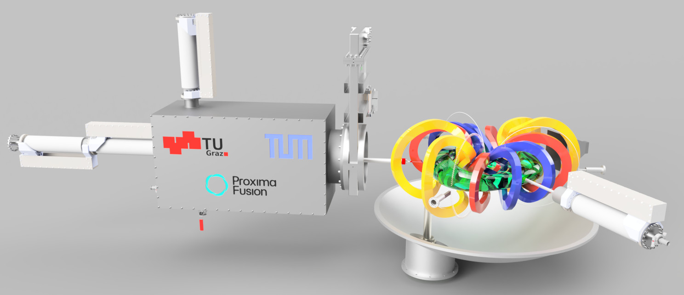

# ALPES - Adaptable Lab for Plasma Experiments in Stellarators

This project contains contributions towards a university-scale stellarator experiments. Results are provided as open source / open data / open educational resources and re-use is encouraged. The initial release is built on the outcome of the joint course "Fusion Reactor Design" in summer 2024 by TU Graz, TU Munich and Proxima Fusion.

## Merging

- Pull requests, including every layer of a stacked PR, run CI.
- Review a stack layer by layer. When it is ready, collapse it into one PR into
  `main` (retarget the top layer to `main`); the lower PRs then show as merged.
- Click "Merge when ready" (or `gh pr merge --merge --auto`). The PR enters the
  merge queue, CI runs on the exact merge result, and on success it lands on
  `main` as a merge commit. `main` itself is not re-tested on push.
- A branch need not be up to date with `main`. Merge `main` into a PR only
  when it conflicts.

## License

Source code and directly related documentation are licensed under the MIT license according to the [LICENSE](LICENSE) file.

Documentation and data not directly related to source code are licensed under the CC BY 4.0 license according to the [LICENSE-docs](LICENSE-docs) file.

Attribution for re-use goes to *The ALPES Team*. When building on our work, we would appreciate a citation of the Zenodo entry and other related publications.
