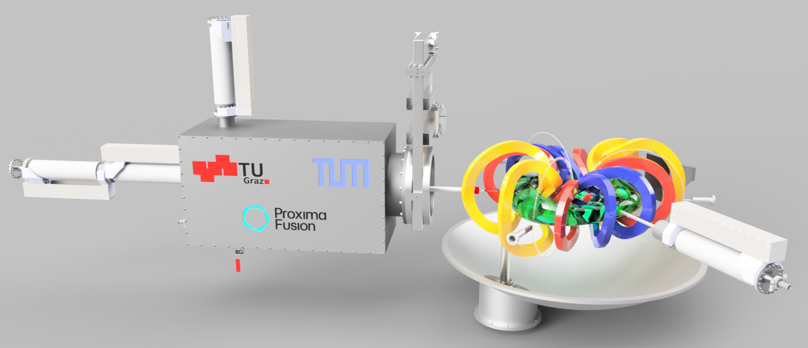

# ALPES - Adaptable Lab for Plasma Experiments in Stellarators

This project contains contributions towards a university-scale stellarator experiment. Results are provided as open source / open data / open educational resources and re-use is encouraged. The initial release is built on the outcome of the joint course "Fusion Reactor Design" in summer 2024 by TU Graz, TU Munich and Proxima Fusion.

## Contents

- `design/`: stellarator configuration (QUASR model 0021326) and optimisation
  scripts for simsopt, SPEC and STELLOPT
- `coils/`: coil coordinates, force calculations and coil design assumptions
- `heating/`: plasma power balance
- `vessel/`: LaTeX notes on the vacuum vessel and CAD
- `summary/`: LaTeX source of the course summary report (`summary.pdf`)
- [CONTRIBUTIONS.md](CONTRIBUTIONS.md): who worked on what

The summary report is built with `make` (runs `pdflatex` in `summary/`).

Contribution and merge guidance: [docs/contributing.md](docs/contributing.md).

## Publications

E. M. Steinwender, C. G. Albert, G. Birkenmeier, D. Mendonça, M. Narnhofer,
N. Oberth, M. Oblak, M. Rosenthal, R. Schennach, J. Schilling, U. Stroth,
M. Tritthart and the ALPES Team, *Designing ALPES: an Adaptable Lab for Plasma
Experiments in Stellarators at university scale*, 51st EPS Conference on Plasma
Physics, Vilnius, 2025, P4.225.
[PDF](https://pure.mpg.de/rest/items/item_3675694/component/file_3675695/content)

## License

Source code and directly related documentation are licensed under the MIT license according to the [LICENSE](LICENSE) file.

Documentation and data not directly related to source code are licensed under the CC BY 4.0 license according to the [LICENSE-docs](LICENSE-docs) file.

Attribution for re-use goes to *The ALPES Team*. When building on our work, we would appreciate a citation of the Zenodo entry and other related publications.
